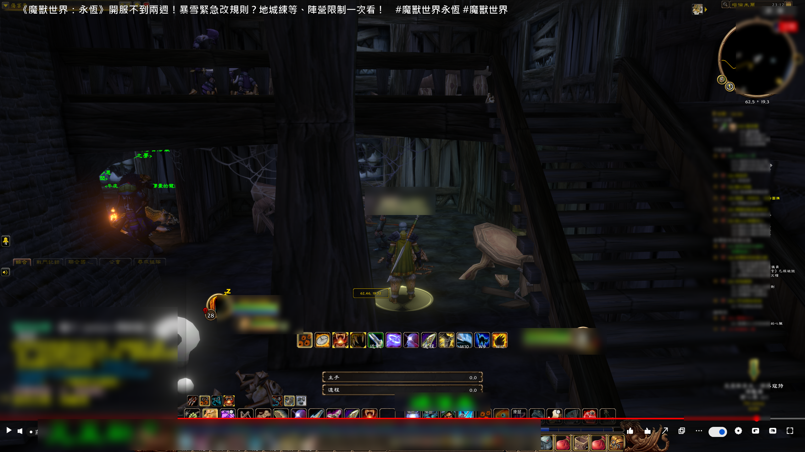

# looks-like-youtube

把「在玩遊戲」偽裝成「在看 YouTube 直播」。

一個全透明、永遠置頂、滑鼠點穿的覆蓋層，只在畫面頂端畫一條影片標題、底端畫一條 YouTube 直播控制列（紅色進度條、`● 直播中`、右側整排工具圖示）。中間整片留空，所以下面跑的是**真正的遊戲畫面**——沒被擷取、沒被合成、沒被縮放，零畫質損失、零幀率成本。

**這是一個 boss key**：有人靠近時，雙手離開鍵盤滑鼠，畫面看起來就是你在看一支遊戲實況。



> 範例截圖是《魔獸世界》的畫面（人物名已模糊）。**標題文字記得換成你自己遊戲的 YouTube 影片／實況標題**，不要照抄——不然別人一看標題跟畫面不符就會起疑。

## 特點

- 純 Win32 + GDI+，**單一 exe、單一 process**，沒有瀏覽器引擎。
- 記憶體約 43 MB、覆蓋層自身 GPU 佔用 **0.0%**、編譯帶 `lto` + `opt-level="z"`，exe 約 176 KB。
- 滑鼠全穿透、永不搶焦點、不進工作列，遊戲照樣收得到每一個點擊。
- 視窗從頭到尾不隱藏，開關只換一張透明點陣圖——避開 Windows 透明視窗反覆 hide/show 會變黑底的老問題。
- 以 1920×1080 為設計座標等比縮放，任何解析度與長寬比都不變形；小解析度時右側圖示列自己壓縮。
- 切換解析度、切換螢幕後會自己跟上，不需要重啟。

## 取得

**直接下載**：抓 repo 根目錄的 `looks-like-youtube.exe` 就能跑，不必裝任何東西。

**自己編**：需要 Rust（`rustup` 裝的 stable 即可）與 MSVC 建置工具。

```bash
cargo build --release
```

產出在 `target/release/looks-like-youtube.exe`，沒有其他相依檔案。

## 使用

第一次啟動會**自動進入校準模式**：用 `↑` `↓` 把控制列移到「蓋不到你的快捷鍵、又不擋畫面」的位置，按 `Enter` 存檔。位置存在 `%APPDATA%\looks-like-youtube\config.json`，之後不用再調。

控制列預設貼著畫面下緣，但會**自動讓開 Windows 工作列**；遊戲全螢幕時沒有工作列，就真的貼底。

## 快捷鍵

| 鍵 | 作用 |
|---|---|
| `Ctrl + Alt + Shift + Y` | 開／關偽裝 |
| `Ctrl + Alt + Shift + K` | 重新校準位置 |

兩組都是冷門組合，不會撞到遊戲、輸入法或瀏覽器。熱鍵是全域註冊的，遊戲在前景時照樣吃得到，而且**不會搶走遊戲焦點**。校準中按開關＝直接存檔並退出校準。

兩組鍵都能改，指令式寫法（`Ctrl+Shift+F9`、`Alt+Win+Y` 這種都吃得下）。

## 換成你自己的內容

編輯 `%APPDATA%\looks-like-youtube\config.json`：

```json
{
  "title": "換成你那款遊戲的 YouTube 影片標題",
  "label": "直播中",
  "showTitle": true,
  "barBottom": 6,
  "toggleHotkey": "Ctrl+Alt+Shift+Y",
  "calibrateHotkey": "Ctrl+Alt+Shift+K"
}
```

- `title`：**最重要的欄位**。去找一支跟你遊戲畫面內容相符的實況或教學影片，把它的標題貼進來。畫面是魔獸、標題寫別的遊戲，是最容易被一眼看穿的破口。
- `label`：左下角標籤，例如改成 `觀看人數 1,204`。
- `showTitle: false`：只留底部控制列。
- `barBottom`：控制列離底邊的像素（用校準鍵調比較快）。
- `toggleHotkey` / `calibrateHotkey`：改熱鍵，寫法如 `Ctrl+Shift+F9`。修飾鍵至少要一個。

改完要重啟程式。

## 原理

- 視窗樣式 `WS_EX_LAYERED | WS_EX_TRANSPARENT | WS_EX_TOPMOST | WS_EX_NOACTIVATE | WS_EX_TOOLWINDOW`：整層滑鼠穿透、壓在遊戲之上、永不搶焦點、不進工作列。
- 畫面用 GDI+ 畫進 32bpp 預乘 alpha 的 DIB，再 `UpdateLayeredWindow(ULW_ALPHA)` 送上螢幕。完全沒有子視窗、沒有瀏覽器引擎。
- 只有一條每 2 秒微動的進度條，重繪頻率低；全螢幕點陣圖會重用，不是每次重配。
- 以 1920×1080 為設計座標等比縮放，控制列永遠貼齊畫面下緣（必要時讓開工作列）。

## 限制

- **只支援視窗化 / 無邊框（視窗化全螢幕）**。真正的獨佔全螢幕會整個蓋掉桌面合成，置頂視窗疊不上去。開遊戲前先把顯示模式改成「視窗化全螢幕」。
- 純靜態：不會真的播放、暫停、拖曳進度條。
- 你只要動滑鼠或按技能，就跟「在看影片」矛盾。前提是**雙手離開**。
- 遊戲內建的滑鼠游標會顯示在覆蓋層上（YouTube 全螢幕時本來也會），這點反而更真。
- Windows 上若前景程式以系統管理員權限執行，滑鼠穿透會失效（UIPI）；把本程式也用管理員權限啟動即可。
- 只在 Windows 11 實測過。

## 授權

MIT
